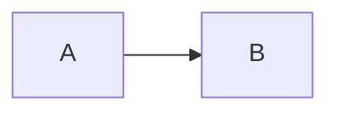

# Question title (phrased as a question)?

> 🌐 [中文](slug.md) · 📅 Checked: YYYY-MM-DD · 🏷️ tag 1, tag 2

## Short answer

The conclusion first, in two or three sentences.

## Explanation

### 1. Background

### 2. …

| Aspect | … | … |
| --- | --- | --- |

## Why it matters

- …

## How it fits the knowledge base

- [NN finished chapter](../NN-topic/README.en.md): …
- **NN planned chapter** (planned): … (no link until the chapter exists)

## Sources

- Primary: official docs / papers / repositories (preferred)
- Secondary: news coverage

> Say which parts come from primary sources and which from coverage or inference, and what may change.
