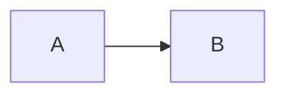

# 问题标题（写成一个问句）？

> 🌐 [English](slug.en.md) · 📅 核实日期：YYYY-MM-DD · 🏷️ 标签 1、标签 2

## 一句话回答

先给结论，两三句话以内。

## 详细解释

### 1. 背景

### 2. ……

| 对比项 | …… | …… |
| --- | --- | --- |

## 为什么重要

- ……

## 与知识库的关系

- [NN 已完成的章节](../NN-topic/README.md)：……
- **NN 计划中的章节**（计划中）：……（计划中的章节不加链接，写成后再补）

## 来源

- 一手资料：官方文档 / 论文 / 代码仓库（优先）
- 二手报道：媒体文章

> 说明哪些内容来自一手资料、哪些来自报道或推测，以及可能会变化的部分。
