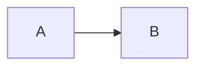

# Topic Name

> **In one sentence:** …
>
> 🌐 [中文版](https://baiyuby.github.io/use_token_to_learn/NN-topic/) · 🎮 **[Open the interactive playground](https://baiyuby.github.io/use_token_to_learn/NN-topic/interactive/topic.html?lang=en)**

[](https://baiyuby.github.io/use_token_to_learn/NN-topic/interactive/topic.html?lang=en)

**In this chapter you will learn:**

- …

---

## 1. Intuition: why do we need it?

## 2. Pictures




> **🎮 Try it yourself**
>
> In the [interactive playground](https://baiyuby.github.io/use_token_to_learn/NN-topic/interactive/topic.html?lang=en) you can:
>
> 1. …

## 3. The math

$$
y = f(x)
$$

## 4. Minimal implementation (PyTorch)

Full code: [`code/topic.py`](code/topic.py)

```python
```

## 5. Common misconceptions

- **“…”** …

## 6. Self-check

1. …

<details>
<summary>Answers</summary>

1. …

</details>

## 7. Further reading

- Author, year. [Title](link)
