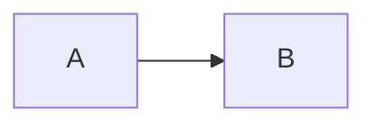

# 主题名称（English Name）

> **一句话总结：** ……
>
> 🌐 [English version](README.en.md) · 🎮 **[打开交互演示](interactive/topic.html?lang=zh)**

[](interactive/topic.html?lang=zh)

**本章你将学会：**

- ……

---

## 1. 直觉：为什么需要它

## 2. 图解




> **🎮 动手试试**
>
> 在[交互演示](interactive/topic.html?lang=zh)中，你可以：
>
> 1. ……

## 3. 数学形式

$$
y = f(x)
$$

## 4. 最小代码实现（PyTorch）

完整代码：[`code/topic.py`](code/topic.py)

```python
```

## 5. 常见误区

- **“……”**：……

## 6. 自测题

1. ……

<details>
<summary>参考答案</summary>

1. ……

</details>

## 7. 延伸阅读

- 作者, 年份. [标题](链接)
